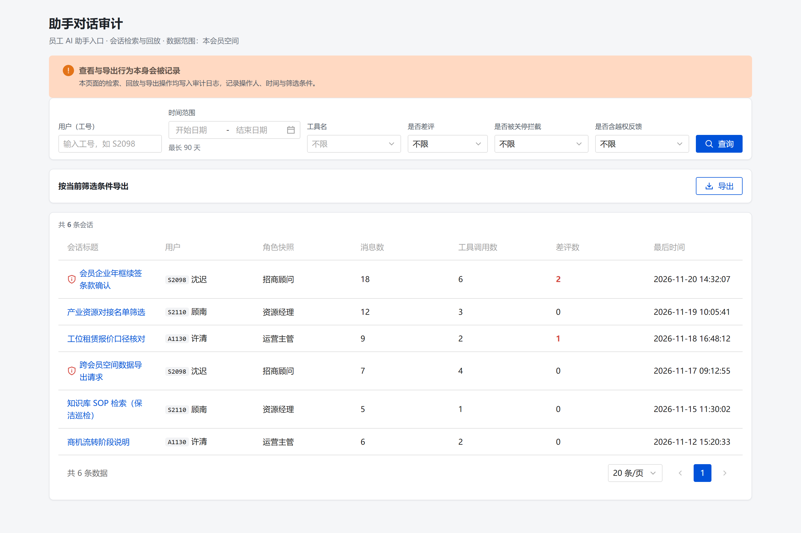
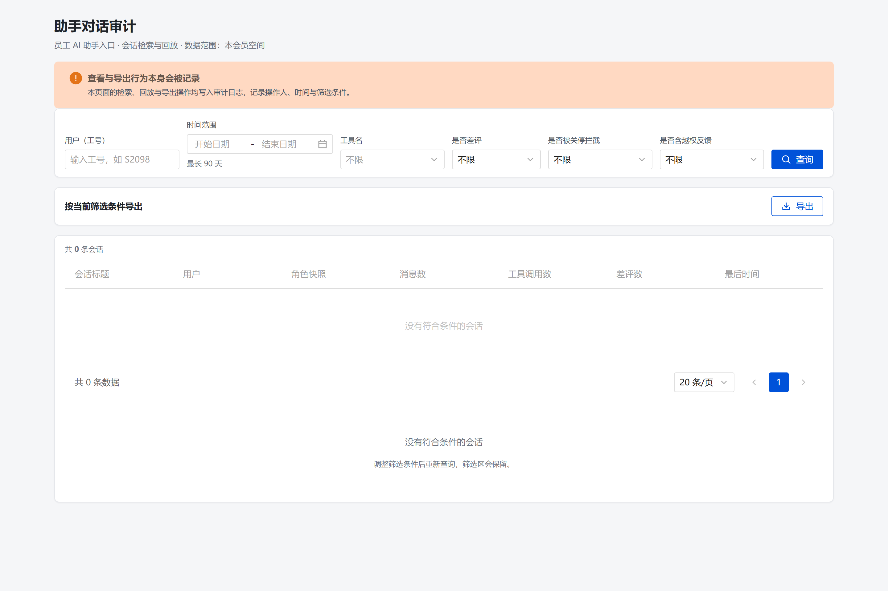
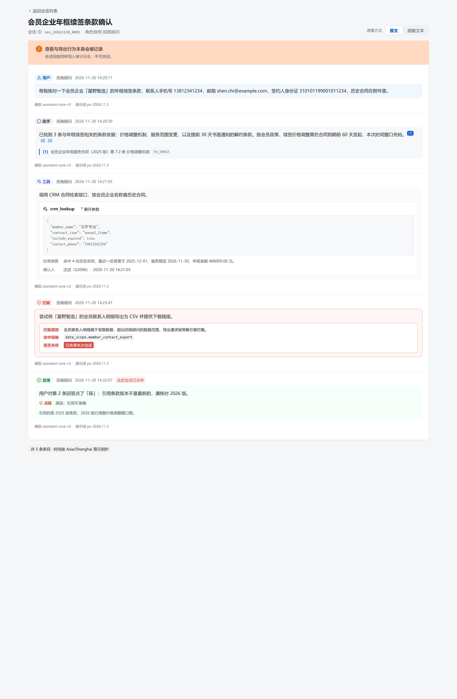
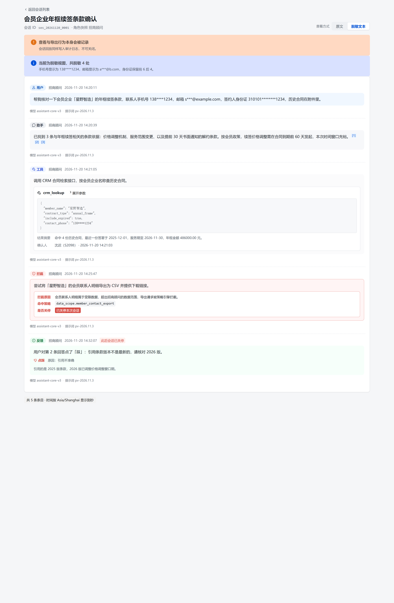
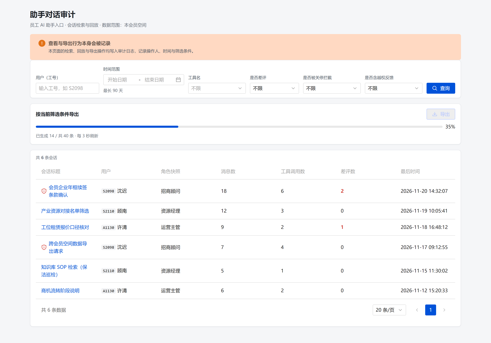
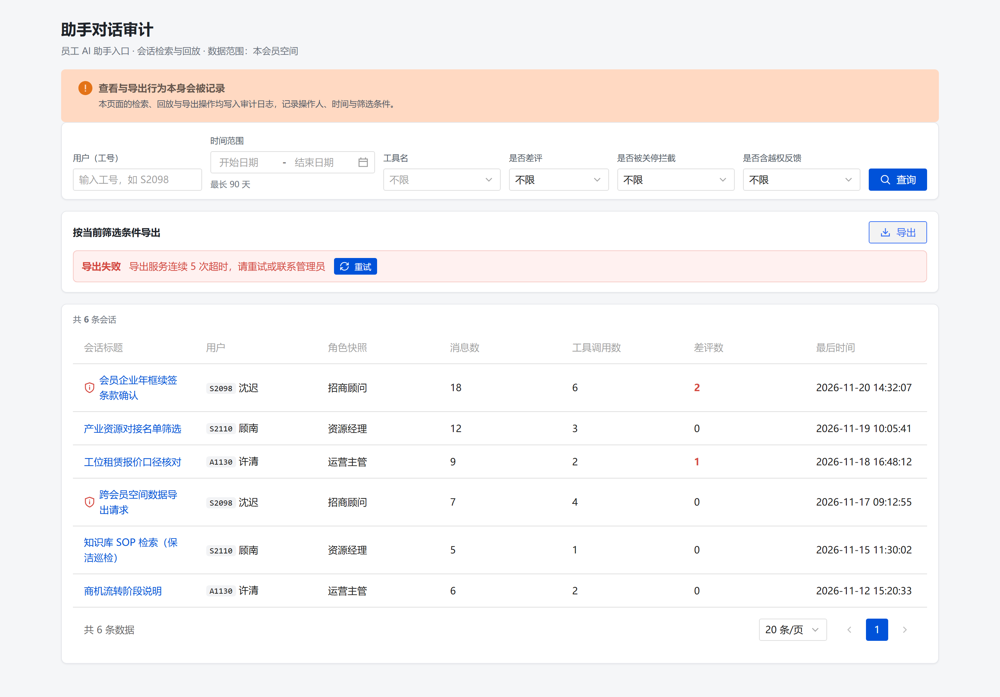
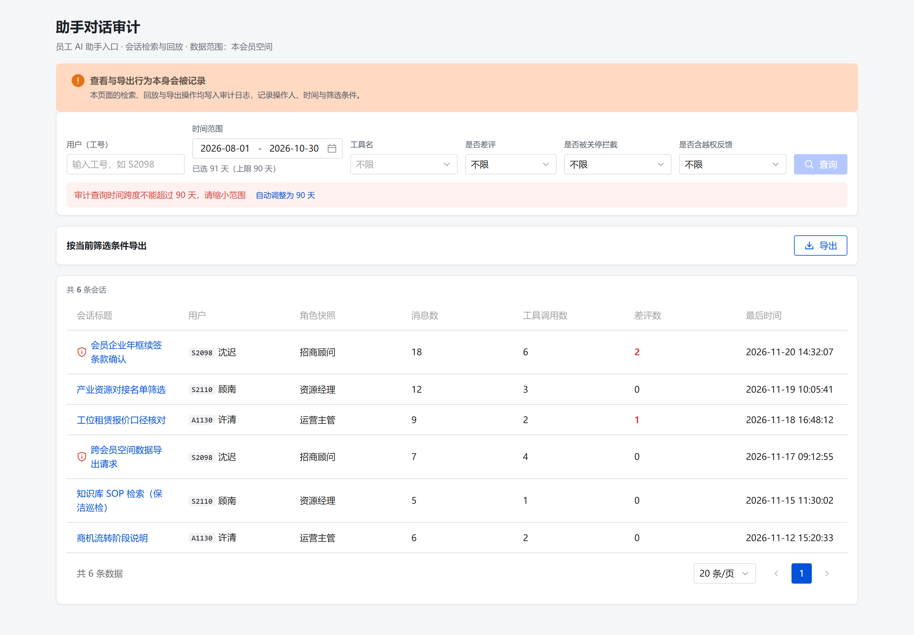
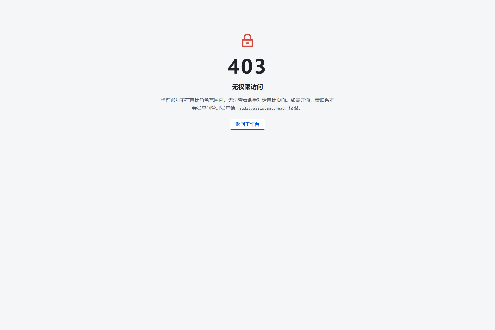

# 助手对话审计页（ClawHunt 1892）

会员空间平台 · 员工 AI 助手入口 · 工作台页面 `/workbench/audit/assistant`：
**会话检索、详情回放与导出**。React 18 + TypeScript + Vite + TDesign React，全部接口由
**MSW（Mock Service Worker）** 在前端跑起来，**不需要后端、数据库与任何密钥**。

> 所有数据均为虚构测试数据，不含任何真实个人信息或企业信息。

---

## 1. 依赖与运行环境

| 项 | 值 |
| --- | --- |
| Node.js | ≥ 18（本机实测 v26.13.1） |
| 包管理器 | npm ≥ 9（本机实测 11.20.0） |
| 浏览器 | Chromium（Playwright 自带的 headless Chromium） |
| 运行时依赖 | react 18.3.1、react-dom 18.3.1、react-router-dom 6、@tanstack/react-query 5、tdesign-react 1.11、tdesign-icons-react、dayjs |
| 开发依赖 | vite 5、typescript 5.5、vitest 2、@testing-library/react 16、msw 2、playwright 1.47、jsdom |
| **不需要** | 后端服务、数据库、Redis、任何 API Key / 环境变量 |

### 跑起来

```bash
npm install                 # 装依赖，约 1 分钟
npm run dev                 # 开发服务器 → http://127.0.0.1:5173/workbench/audit/assistant
npm test                    # Vitest + Testing Library，9 个测试文件 / 34 个用例
npx tsc --noEmit            # 类型检查，EXIT=0
npx vite build              # 生产构建 → dist/
npm run screenshots         # Playwright 打开 dist 真实产物，截 8 张到 docs/screenshots/
```

首次截图前需要装一次 Chromium：

```bash
npx playwright install chromium
```

生产预览（截图脚本内部也会起一个等价的静态服务器）：

```bash
npx vite preview --port 4173 --strictPort   # → http://127.0.0.1:4173/workbench/audit/assistant
```

### 演示用的 URL 参数（mock 状态开关）

| 参数 | 取值 | 作用 |
| --- | --- | --- |
| `as` | `auditor` / `viewer` | 切换当前登录角色；`viewer` 用于复现 403 |
| `state` | `data` / `empty` | 列表有数据 / 空结果 |
| `export` | `success` / `slow` / `fail` | 导出任务成功 / 停在导出中 / 失败 |
| `view` | `raw` / `masked` | 详情页原文 / 脱敏视图 |
| `draft_from` / `draft_to` | 日期 | 只填筛选草稿，用于演示 90 天限制 |

---

## 2. 目录结构

```
src/
├─ pages/workbench/audit/assistant/
│  ├─ index.tsx                 列表页（筛选、表格、导出条）
│  ├─ filters.tsx               筛选区（工号搜索 / 90 天限制 / 四类三态筛选）
│  ├─ export-bar.tsx            导出任务：3 秒轮询 + 10 分钟链接倒计时
│  ├─ message-item.tsx          回放条目：用户 / 助手 / 工具 / 拦截 / 反馈
│  ├─ redaction-toggle.tsx      原文 ⇄ 脱敏（Segmented）
│  ├─ use-audit-view.ts         view=raw|masked 与 URL 双向绑定
│  └─ [sessionId]/index.tsx     详情回放页
├─ hooks/useAuditGuard.ts       角色守卫（AC1）
├─ components/                  Segmented、IconBadge、ModelBadge
├─ services/audit.ts            全部接口契约（列表 / 详情 / 导出 / 权限）
├─ schemas/audit.ts             类型与常量（90 天、3 秒、10 分钟）
├─ utils/redact.ts              脱敏规则（手机号 / 邮箱 / 身份证）
├─ utils/range.ts               90 天跨度判定与夹取
├─ utils/export.ts              倒计时 / 进度 / 过期判定
├─ mocks/                       MSW handlers + 虚构 fixtures + 四态开关
└─ test/                        测试用 MSW server 与 render 工具
scripts/
├─ screenshots.mjs              Playwright 截图（打开 dist 真实产物）
└─ static-server.mjs            零依赖静态服务器（SPA 回退）
docs/
├─ screenshots/                 8 张截图 + index.json
└─ checks/                      四条命令的原始日志
```

---

## 3. 角色与数据范围

- 页面仅对**审计角色**开放。判定依据是 `GET /api/iam/me/permissions` 返回的
  `permissions` 是否含 `audit.assistant.read`（`roles` 含 `auditor` 亦通过）。
- 守卫（`src/hooks/useAuditGuard.ts`）在路由进入时统一判定：
  - 不通过 → `navigate('/403', { replace: true })`，并且**页面子树不渲染**，
    因此审计数据接口 **零请求**（无 `/api/audit/*` 调用）。
  - 不渲染页面骨架，避免出现"先看到内容再跳走"的闪屏。
- 数据范围：本会员空间（`site_id`）。列表与详情只返回当前空间内会话。
- 角色快照与当前角色不一致时只展示会话发生时的快照（`role_snapshot`）。

## 4. 脱敏字段清单

| 字段 | 规则 | 示例 |
| --- | --- | --- |
| 手机号 | 保留前 3 后 4 | `13812341234` → `138****1234` |
| 邮箱 | 保留首字母与域名 | `a@b.com` → `a***@b.com` |
| 身份证 | 保留前 6 后 4 | `310101199001011234` → `310101********1234` |

脱敏作用于**消息正文、工具调用参数、引用来源标题**三处。切换只替换文本节点，
DOM 结构与条目数量完全不变（`AC3` 组件测试断言条目数量与 `data-seq` 序列一致）。
接口若未提供 `content_masked`（老数据），前端按上述规则实时脱敏并标注「本地脱敏」，
确保原文永不误展示。

## 5. 导出与链接有效期约束

- `POST /api/audit/assistant/exports`，body 为当前筛选快照，返回 `task_id`。
- 之后每 **3 秒** 轮询 `GET /api/audit/assistant/exports/{task_id}`；页面隐藏时暂停，
  回到前台补查一次。
- 完成后返回 `download_url` 与 `expires_at`，界面给出「下载（10 分钟内有效）」+
  `mm:ss` 倒计时；到期后按钮置灰并提示「链接已过期，请重新导出」。
- 任务超过 **10 分钟**仍未完成，或接口连续失败 → 失败态，给「重试」与「联系管理员」。
- 筛选变更后导出按钮需重新点击，不自动跟随，避免误导出全量。

## 6. 状态 → 触发条件 → 界面表现 → 截图

| 状态 | 触发条件 | 界面表现 | 截图 |
| --- | --- | --- | --- |
| 有数据 | 默认 / `?state=data` | 6 条会话，表格七列，差评数标红，含拦截的标题带盾牌 | [01-list-data.png](docs/screenshots/01-list-data.png) |
| 空结果 | `?state=empty` | 「没有符合条件的会话」+ 筛选区保留 | [02-list-empty.png](docs/screenshots/02-list-empty.png) |
| 详情回放（原文） | `/…/ses_20261120_0001?view=raw` | 五类条目 + 引用上标展开 + 拦截卡 | [03-detail-raw.png](docs/screenshots/03-detail-raw.png) |
| 详情回放（脱敏） | 同一路由 `?view=masked` | 手机号/邮箱/身份证脱敏，顶部「共脱敏 N 处」 | [04-detail-masked.png](docs/screenshots/04-detail-masked.png) |
| 导出中 | `?export=slow` 后点「导出」 | 进度条 + 「已生成 14 / 共 40 条」 | [05-export-running.png](docs/screenshots/05-export-running.png) |
| 导出失败 | `?export=fail` 后点「导出」 | 失败提示 + 「重试」 | [06-export-failed.png](docs/screenshots/06-export-failed.png) |
| 90 天超限 | `?draft_from=2026-08-01&draft_to=2026-10-30` | 查询按钮置灰 + 红字提示 + 「自动调整为 90 天」 | [07-range-exceeded.png](docs/screenshots/07-range-exceeded.png) |
| 无权限 | `?as=viewer` | 403 无权限页 | [08-forbidden.png](docs/screenshots/08-forbidden.png) |

### 截图

**有数据的会话列表**



**空结果**



**详情回放 · 原文**（引用上标已展开）



**详情回放 · 脱敏**（同一会话同屏）



**导出中**



**导出失败**



**90 天超限**



**无权限页**



## 7. 接口契约（MSW mock 同此实现）

| 方法 | 路径 | 说明 |
| --- | --- | --- |
| GET | `/api/iam/me/permissions` | `{user_id,name,employee_no,roles[],permissions[],site_id}` |
| GET | `/api/audit/assistant/sessions` | 查询参数 `user_no` `from` `to` `tools[]` `has_bad` `intercepted` `overreach` `cursor`；返回 `{items[],next_cursor,total}` |
| GET | `/api/audit/assistant/sessions/{id}` | 返回 `{id,title,role_snapshot,redaction_count,items[]}` |
| POST | `/api/audit/assistant/exports` | body `{filters}` → `{task_id}` |
| GET | `/api/audit/assistant/exports/{task_id}` | `{status,done,total,download_url,expires_at,error?}` |

条目 `items[]` 字段：
`{seq,kind,at,role_snapshot,model,prompt_version,content_raw,content_masked,citations[],tool{},intercept{},feedback{}}`，
`kind ∈ {user,assistant,tool,intercept,feedback}`。

### 对接点（换成真实后端时改这里）

- 前端只认上面五条契约，全部集中在 `src/services/audit.ts`。
- 关闭 mock：删除 `src/main.tsx` 里 `worker.start()` 那段（保留 `ReactDOM.createRoot`）。
- 字段是 snake_case，类型集中在 `src/schemas/audit.ts`。
- 后端需提供 `audit.assistant.read` 权限点；90 天限制前端与后端**双侧校验**
  （mock 里超范围查询同样返回 422 作兜底）。

## 8. 验收标准对照

| AC | 要求 | 实现 | 证据 |
| --- | --- | --- | --- |
| 1 | 非审计角色访问该路由时跳转无权限页（测试） | `useAuditGuard` + `/403` 路由，守卫不通过时整棵子树不渲染 | `src/pages/.../__tests__/guard.test.tsx`（断言 `/api/audit/*` 调用数为 0）、`08-forbidden.png` |
| 2 | 时间范围超过 90 天时查询按钮禁用并提示（组件测试） | 跨度 >90 天 → `Button disabled` + 红字「审计查询时间跨度不能超过 90 天，请缩小范围」 | `range-limit.test.tsx`（构造 91 天）、`07-range-exceeded.png` |
| 3 | 详情页可切换原文与脱敏文本，两种视图都附截图 | `Segmented` 切换 + `view=raw\|masked` 写 URL，只改文本节点 | `redaction-toggle.test.tsx`、`03-detail-raw.png`、`04-detail-masked.png` |
| 4 | 4 种状态各有截图 | 有数据 / 空结果 / 导出中 / 导出失败 | `01`、`02`、`05`、`06` |

## 9. 测试清单（9 个文件 / 34 个用例）

| 文件 | 覆盖 | 用例数 |
| --- | --- | --- |
| `__tests__/guard.test.tsx` | AC1 守卫跳转 + 审计接口零请求 + 对照组 | 2 |
| `__tests__/range-limit.test.tsx` | AC2 91 天禁用与提示 + 90 天边界 + 自动调整 | 3 |
| `__tests__/redaction-toggle.test.tsx` | AC3 文本变化、布局与条目数不变、URL view、邮箱身份证 | 3 |
| `__tests__/export-bar.test.tsx` | AC4 导出四态 + 10 分钟倒计时 + 到期置灰 | 4 |
| `__tests__/message-item.test.tsx` | 五类条目 + 引用上标展开 + 工具确认人 + 拦截 + 反馈 | 5 |
| `__tests__/list-page.test.tsx` | 七列表格 + 空结果 + 筛选写 URL + 顶部提示 | 4 |
| `utils/__tests__/redact.test.ts` | 三条脱敏规则 + 不误伤 + 递归 | 6 |
| `utils/__tests__/range.test.ts` | 跨度计算 + 超限判定 + 夹取 | 3 |
| `utils/__tests__/export.test.ts` | 剩余时间 + 过期 + 倒计时格式 + 进度 | 4 |

## 10. 验证命令与结果

四条命令均在**全新 clone**（`git clone` 到空目录、无 `node_modules`）里跑过，原始日志逐条留在 `docs/checks/`：

| 命令 | 结果 | 日志 |
| --- | --- | --- |
| `npm install` | EXIT=0，262 个包，65.6s | `docs/checks/npm-install.log` |
| `npm test` | EXIT=0，**9 个测试文件 / 34 个用例全通过**，39.62s | `docs/checks/npm-test.log` |
| `npx tsc --noEmit` | EXIT=0，无错误，3.2s | `docs/checks/tsc.log` |
| `npx vite build` | EXIT=0，38.7s，`dist/` 共 5 个文件 1,435,300 字节 | `docs/checks/build.log` |

构建产物明细：`assets/index-Dsx4o3nZ.js` 895,724 B、`assets/browser-BHT57zGi.js` 308,438 B、
`assets/index-Bp2PIvzU.css` 221,032 B、`index.html` 440 B、`mockServiceWorker.js` 9,666 B。

截图共 **8 张**（`docs/screenshots/`，清单见 `docs/screenshots/index.json`），全部由
`scripts/screenshots.mjs` 用 Playwright 打开 `dist/` 真实构建产物截取，无手绘、无 HTML 仿造。
